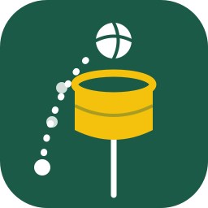

# Korf tools

Two free, single-file web apps for korfball, created by Eric Van Looy. They run in your browser: nothing to install and nothing uploaded.

| | |
|---|---|
|  | **Korf Log** Record a match live, one click at a time: passes, shots, turnovers, substitutions. Exports an event log (CSV or JSON).  **[Open Korf Log](https://ericvl-korf.github.io/korf-tools/Korf%20Log.html)** · [User guide](docs/Korf-Log-user-guide.md) · [Video tutorial](tutorials/korf-log-tutorial.mp4) |
|  | **Korf Lab** Reads the event logs and builds team and player dashboards, shot maps, attack replays and printable PDF reports.  **[Open Korf Lab](https://ericvl-korf.github.io/korf-tools/Korf%20Lab.html)** · [User guide](docs/Korf-Lab-user-guide.md) · [Video tutorial](tutorials/korf-lab-tutorial.mp4) |

> ### Need your matches tracked?
> Short on time? I can track your club's matches for you, from a video of the match, and send you the event log ready for Korf Lab.
>
> | Service | Price | What you get |
> |---|---|---|
> | **Basic match tracking** | **£5 per match** | Line-ups, shots and goals, without passes and shot types |
> | **Full match tracking** | **£10 per match** | Line-ups, shots and goals, every pass and the type of each shot |
>
> To get started, [email me](mailto:eric.vanlooy1982@gmail.com?subject=Korf%20match%20tracking%20request&body=Hi%20Eric%2C%0A%0AI%27d%20like%20to%20book%20match%20tracking.%0A%0ATracking%20option%20%28basic%20%C2%A35%20or%20full%20%C2%A310%29%3A%0AClub%3A%0ALeague%3A%0ATeam%20name%3A%0AOpponent%20name%3A%0AMatch%20date%3A%0A%0APlayer%20names%20%28line-up%20and%20subs%29%2C%20our%20team%3A%0A%0APlayer%20names%20%28line-up%20and%20subs%29%2C%20opponent%20%28if%20known%29%3A%0A%0AYouTube%20link%28s%29%20to%20the%20match%20video%20%28one%20per%20half%20if%20it%20is%20split%29%3A%0A%0AThanks%21): the email is pre-filled with what I need (player names for the line-up and subs, and the YouTube link to the match video).

## Latest features

- **2026-11-05**: **Korf Log:** the logo goes back to the start screen; Check times always offers the video file choosers and the automatic checks (even with a YouTube link); tap sync can switch between the 1st and 2nd half video.
- **2026-11-03**: **Korf Log:** the Match + video ±1 s buttons sit beside Start/Pause, with a Pause / Resume button in the Transfer panel and pop-ups, and an export prompt after times are corrected. **Korf Lab:** with several matches selected, only stats every match logged are shown.
- **2026-11-02**: **Korf Log:** injured players can go off without a replacement and new players can come on later. Both video tutorials have background music and run 2:45.
- **2026-11-01**: **Korf Log:** setup step 2 has a preview player to find the start of each half and set the video offset straight away.
- **2026-10-31**: **Korf Log:** a step-by-step start and setup, tap sync for YouTube videos, flagging of mistimed shots, ball finding while you track, and a re-recorded tutorial. **Korf Lab:** it opens with a question about which files to load, dropdown filters and a print menu, best clips, and tighter ball-following in highlight clips.
- **2026-10-25**: **Korf Log:** Check times against the video re-times the log. **Korf Lab:** a ball finder for your video, portrait and ball-following highlight videos, penalty and free pass clips, and a step checklist for making a highlight reel.
- **2026-10-24**: **Korf Lab:** hover a greyed-out button to see what is missing.
- **2026-10-22**: **Korf Log:** Both −1 s / +1 s buttons move video and clock together, and the Speed buttons set the video speed too.
- **2026-10-21**: **Video support:** video tutorials, a match video at setup (YouTube or file) in Korf Log, Time out start / end buttons, and the Highlights page and highlight reel in Korf Lab.

## Download

### GitHub link or saved copy?

| | Open from GitHub | Locally saved copy |
|:---|:---:|:---:|
| Always the latest version | ✔ | ✖ |
| Saved matches stay put (one fixed address) | ✔ | ✖ (tied to where the file is saved) |
| Works with no internet connection | ✖ | ✔ |
| Korf Lab ball finder | ✔ | ✔ (needs internet, it loads from GitHub) |
| Your match data stays in your browser, nothing uploaded | ✔ | ✔ |

### Keeping a saved copy

To keep a copy and open it offline in any browser:

- **Direct download:** right-click a link and choose **Save link as…** (on a phone, long-press and choose Download link):
  [Korf Log.html](https://raw.githubusercontent.com/ericvl-korf/korf-tools/main/Korf%20Log.html) · [Korf Lab.html](https://raw.githubusercontent.com/ericvl-korf/korf-tools/main/Korf%20Lab.html)
- **From GitHub:** open the file in this repository and use the download icon at the top right of the file view.
- **Everything:** choose **Code → Download ZIP** on the repository home page.

Then double-click the saved file to open it. Matches are stored per browser and per file location, so a downloaded copy starts empty. Export a backup before moving between the web version and a downloaded copy.

## Notes

- Everything runs in your browser; nothing is uploaded. Matches are stored in the browser on the page's address, so export a backup before switching address or device.
- Korf Lab has a **Sample file** option to try it without data.
- Both apps are plain HTML files: save the file and open it locally if you prefer.

**Privacy.** This site counts anonymous page visits and file downloads (no cookies, no personal data). Your match data never leaves your browser.

## Contact

Want something added or changed, found a problem, or have another request? [Contact](mailto:eric.vanlooy1982@gmail.com?subject=Korf%20tools%20request&body=Hi%20Eric%2C%0A%0AWhich%20app%20is%20this%20about%20%28Korf%20Log%20or%20Korf%20Lab%29%3F%0A%0AWhat%20would%20you%20like%20%28a%20new%20feature%2C%20a%20change%2C%20a%20fix%20or%20something%20else%29%3F%0A%0AAny%20details%2C%20examples%20or%20screenshots%3A%0A%0AThanks%21) me.
