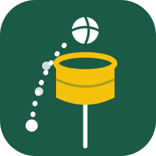
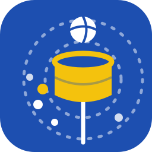

# Korf tools

 

Two free, single-file web apps for korfball, created by Eric Van Looy.

## Latest features

- **2026-10-21 00:07 (Europe/London)**: New features today:
  - **Video tutorials:** a short captioned walkthrough of each app (Korf Log 1:28, Korf Lab 1:29, in the [tutorials](tutorials/) folder) behind a new **Video tutorial** button at the top of Korf Log and Korf Lab. The Korf Log one includes the match video and the Time out buttons.
  - **Match video at setup (Korf Log):** add a YouTube link or a local video file in match setup, as one video or one per half, with the video time each half starts. Start moves the video to the right moment, and the video and clock ±1 s buttons keep the alignment saved. Links, file names and start times carry into Korf Lab.
  - **Time out start / end (Korf Log):** two Time out buttons replace the single one. The match clock stops and restarts while the video keeps running, and the video time of each time out is saved so clock and video stay lined up, including in Korf Lab highlight reels.
  - **Highlights page (Korf Lab):** list and filter every shot by half, team, division, gender, shooter, shot type, outcome and attack number, with clip start and end times and YouTube links.
  - **Highlight reel (Korf Lab, with its own section in the user guide):** Play all on YouTube, make one highlight video from a local video file, or save an ffmpeg script. Files are named after the match plus _highlights; the script keeps only the merged file by default, with tick boxes for a portrait 10:16 centre-crop frame (Instagram), captions burned into the clips, and individual clips instead of one video.

| App | What it does | Open |
|---|---|---|
| **Korf Log** | Record a match live, one click at a time: passes, shots, turnovers, substitutions. Exports an event log (CSV or JSON). | [Open Korf Log](https://ericvl-korf.github.io/korf-tools/Korf%20Log.html) |
| **Korf Lab** | Reads the event logs and builds team and player dashboards, shot maps, attack replays and printable PDF reports. | [Open Korf Lab](https://ericvl-korf.github.io/korf-tools/Korf%20Lab.html) |

## User guides

- [Korf Log user guide](docs/Korf-Log-user-guide.md)
- [Korf Lab user guide](docs/Korf-Lab-user-guide.md)

## Download

To keep a copy and open it offline in any browser:

- **Direct download:** right-click a link and choose **Save link as…** (on a phone, long-press and choose Download link):
  [Korf Log.html](https://raw.githubusercontent.com/ericvl-korf/korf-tools/main/Korf%20Log.html) · [Korf Lab.html](https://raw.githubusercontent.com/ericvl-korf/korf-tools/main/Korf%20Lab.html)
- **From GitHub:** open the file in this repository and use the download icon at the top right of the file view.
- **Everything:** choose **Code → Download ZIP** on the repository home page.

Then double-click the saved file to open it. Matches are stored per browser and per file location, so a downloaded copy starts empty. Export a backup before moving between the web version and a downloaded copy.

## Notes

- Everything runs in your browser; nothing is uploaded. Matches are stored in the browser on the page's address, so export a backup before switching address or device.
- Korf Lab has a **Load a sample match** button to try it without data.
- Both apps are plain HTML files: save the file and open it locally if you prefer.

**Privacy.** This site counts anonymous page visits and file downloads (no cookies, no personal data). Your match data never leaves your browser.
