# Korf Lab: user guide

Korf Lab reads the event logs exported by Korf Log and builds team and player dashboards that you can print as PDF reports.

## 1. Load your data

- In **Data sources**, press **Choose folder** and pick the folder holding your CSV files, or **Pick CSV files** to select files by hand. Korf Lab reads the CSV event logs and the JSON backups saved from Korf Log (a JSON file is converted when it loads, with the same results as its CSV). Load each match once, as either CSV or JSON, or it is counted twice. Folder access needs Chrome or Edge.
- No folder is remembered, so choose it again each time you open the page. Files picked by hand are kept in the browser.
- Each file shows its number of events. Remove a file from its row, or reload everything.
- Shot Location exports from Yellow Bucket cannot be loaded directly. Convert them first in the same pane (see section 5).
- To try Korf Lab without any data, press **Load a sample match**. It adds a made-up match (Team A v Team B) that you can explore and remove again. It is not real data and may contain slight mistakes.

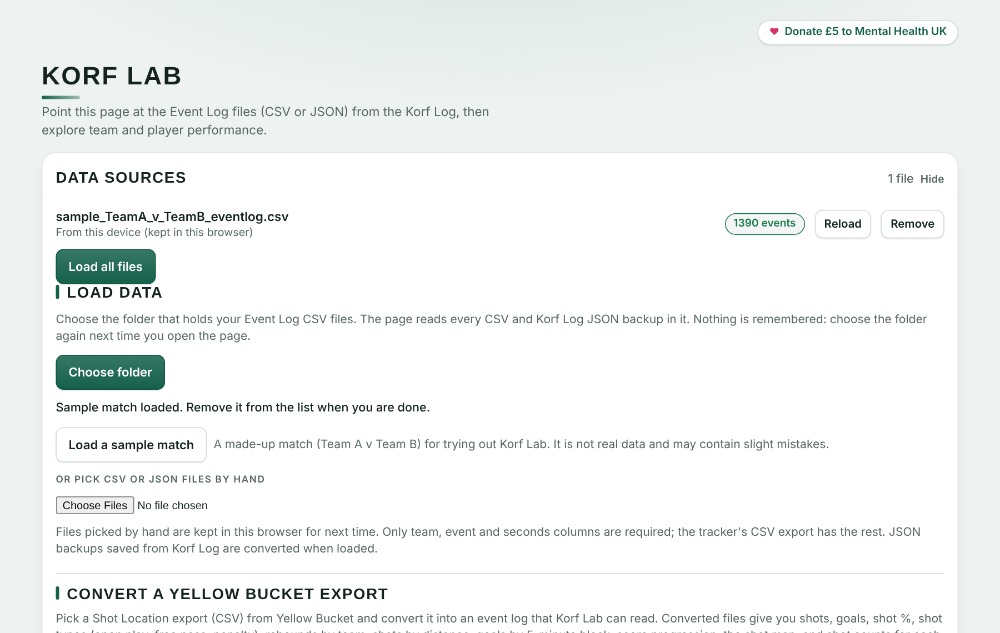

## 2. Explore

- **Team and match filters:** show one team or all teams, one match or all matches.
- **Team and Players pages:** switch between the team dashboard and the player table. Pick a player for their profile.
- **All players table:** the Shots and Goals groups each have their own underline, with a gap between them. Select any column heading to sort by it (names A to Z first, numbers highest first), and select it again to reverse the order. Select a row to open that player's profile.
- **Player highlight:** on the Players page, the selected player is highlighted by name in every chart that compares players (the goals, shots and shot % leaderboards and the volume against efficiency chart), so you can see where they stand against the others. Pick another player from the list, a table row or a chart to move the highlight.
- **Minutes in attack and in defence, and per-minute rates:** when a loaded event log carries the starting line-up (logs saved by the current Korf Log, CSV or JSON), Korf Lab works out how long each player spent in the attacking zone and in the defending zone. A player is in attack while their division is their team's attacking division (the divisions swap after every second goal), and substitutions are followed minute by minute. The player profile shows minutes in attack, minutes in defence, and shots and goals per minute in attack, with match-by-match charts. The Players page adds a Minutes played leaderboard, Shots per minute in attack and Goals per minute in attack leaderboards (every player with time in attack), Time columns in All players and extra buttons in Player by match. Players who start and are never substituted count as playing the whole match; a starter who never shoots shows 0/min; bench players who never come on are not listed. Older event logs without a line-up do not show these visuals.
- **Highlights page:** the third page lists every logged shot and filters it by **Shooter**, **Shot type**, **Outcome** (goals or misses), **Attack** (multi-shot or single-shot) and **Attack no.** (the multi-attack index). Set **Seconds before** and **Seconds after** to choose how much of the play each clip includes. Under the filters, each match has a place for its video: a YouTube link (and a separate 2nd half link if the halves are separate videos) or a video file from your computer, with the video time at which each half starts. These are filled in automatically when the log was made in Korf Log with a video; otherwise type them in (mm:ss, for example 04:10). The list then shows each clip's start and end and a YouTube link that opens at the start. **Save CSV** exports the list; **Copy list** copies it as text.
- **Highlight reel:** under the filters, **Play all on YouTube** plays the filtered clips one after another in an embedded player (it needs Korf Lab opened from a web address). With a video file chosen, **Make highlight video** plays each clip from your file and records them into one new video, optionally with a caption (shooter, shot type, time). It records at normal playback speed, so keep the tab open and visible; the result is saved as an .mp4 (or .webm in some browsers), named after the match as in the event log followed by _highlights, for example Team A v Team B_highlights.mp4. For a faster result, **ffmpeg script (Windows)** or **(Mac/Linux)** saves a small script that cuts and joins the clips with ffmpeg: put it next to your video file and run it. The script is named the same way and leaves only the merged _highlights video; the individual clips are removed. Tick **16:9 frame for the ffmpeg script (Instagram)** before saving it to get a 16:9 (1280 × 720) video, with black bars if your footage is another shape; leave it unticked to keep the video's original size. A file stays on your computer; nothing is uploaded.
- **Shot map:** filter by shot type, division, half and gender, and colour the marks by team, shot type, gender, division or half. The shot type buttons appear when the logs contain more than one shot type. The **Mark size** slider scales the dots.
- Other charts cover score progression, how attacks end, passes per attack and substitutions. Statistics missing from your logs are hidden.
- **Shot distance histogram:** on the Team page, the number of shots in each 1 m band from the post (0–1 m, 1–2 m and so on, with the last band collecting everything beyond 12 m), one set of bars per team. It counts every shot type. Hover a bar for the shots, goals and shot % in that band, or switch to the table.
- **Attack replay:** on the Team page, step through one attack on the full court. Pick a team and an attack (each is listed with its start time, number of passes, number of shots and final outcome, such as Goal, Rebound by defence or Turnover). The first three choices in the attack list, 1st half, 2nd half and Whole match, play all of those attacks one after another: each attack is drawn on its own, held for a moment on its last step, then the next one starts. The caption shows which attack you are on, for example Attack 3 of 33. Next and Back also move from one attack to the next. Press **Play**, or use **Next**, **Back**, **Restart** and the slider to go step by step. Each step adds a numbered pass arrow, then the shot (a gold ring marks a goal) and any rebound, while earlier steps fade. Speed can be set to 0.5×, 1× or 2×. When the attack on screen ended in a goal, **Similar attacks** lists the team's ten attacks that look most like it, whatever their outcome: goals first, then attacks that did not score but won an attacking rebound, then the rest, each with its match percentage and a small drawing of its route on the half court where it was played. Press **Show this attack** to load one into the replay. The button is greyed out for attacks that did not end in a goal, and for goals tracked with Count tracking in Korf Log, because those have no pass locations to compare (such attacks are also left out of the lists). The card needs logs that record passes, so it does not appear for converted Yellow Bucket files. It is for the screen only and never appears in printed reports. If your device is set to reduce motion, automatic playback is switched off and you step through manually.

*The figures below use one simulated match, Team A v Team B, filtered to Team A.*

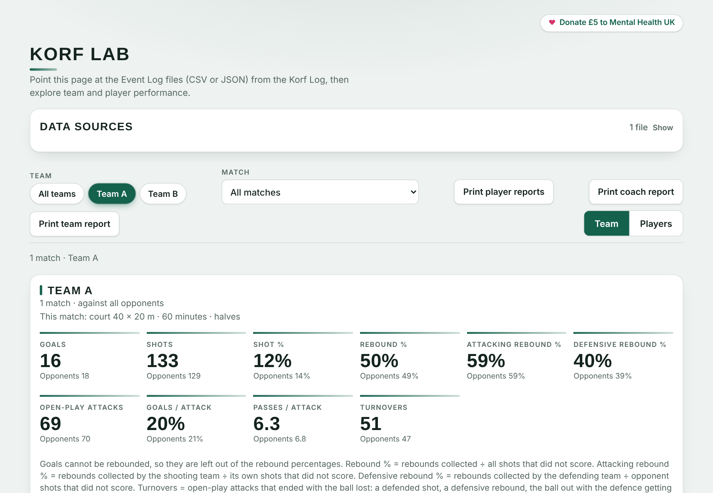

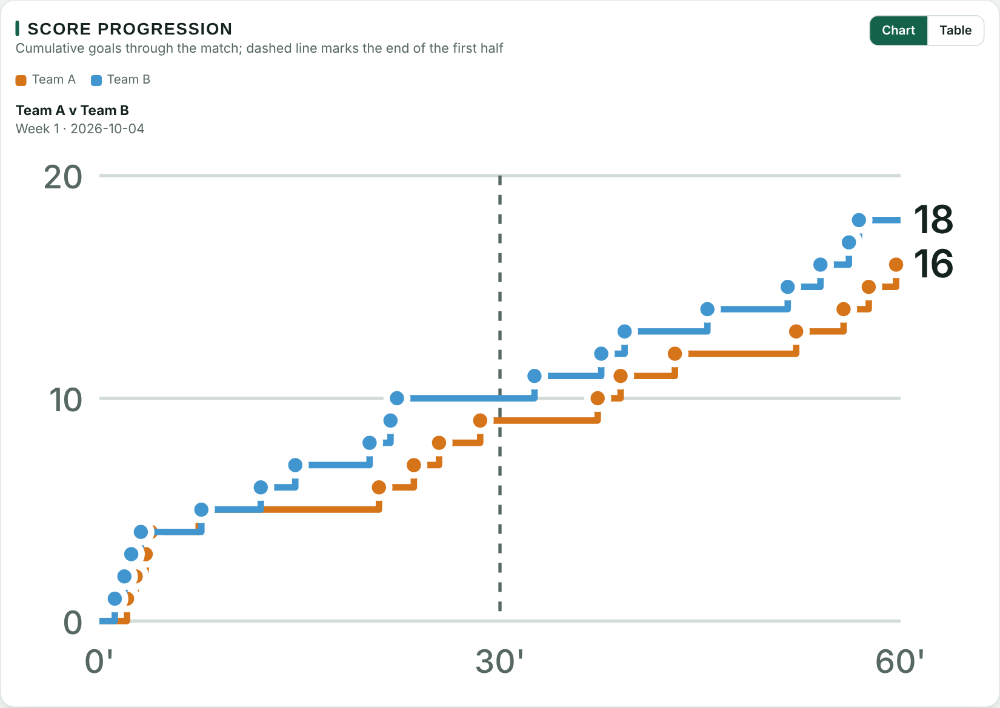

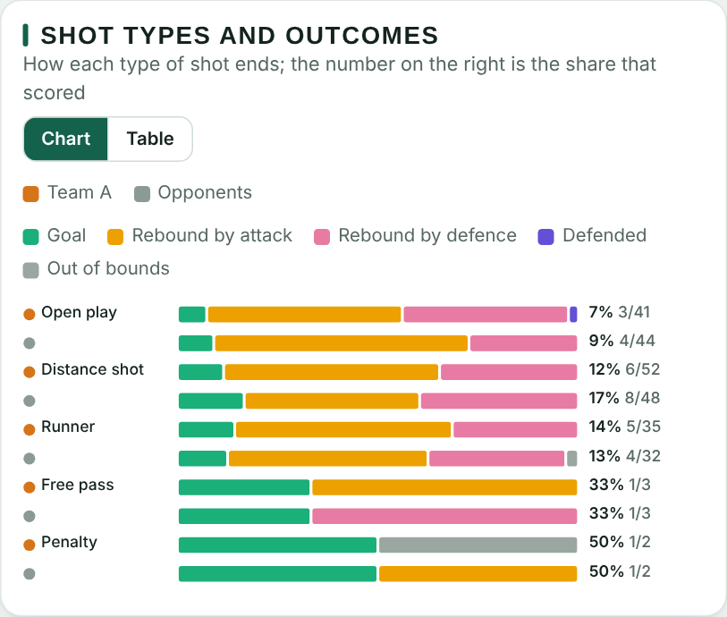

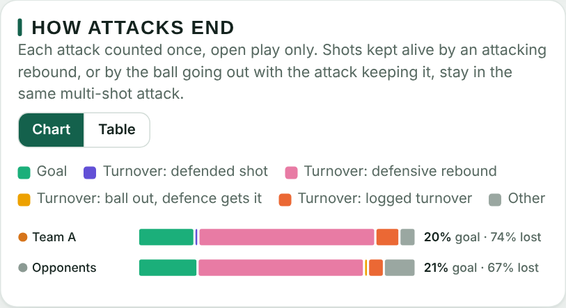

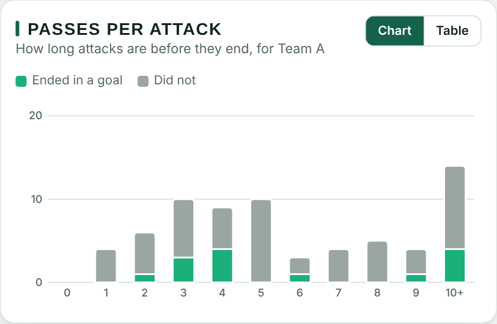

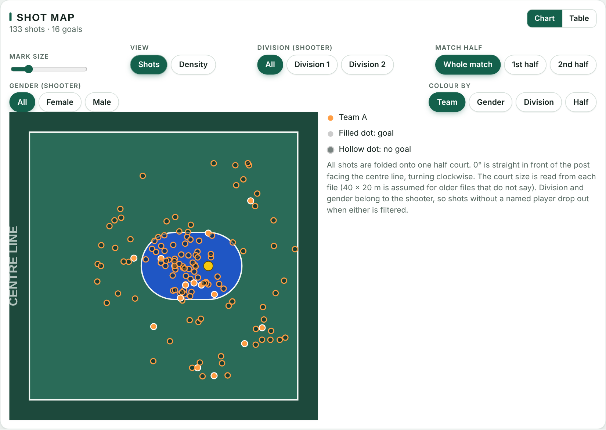

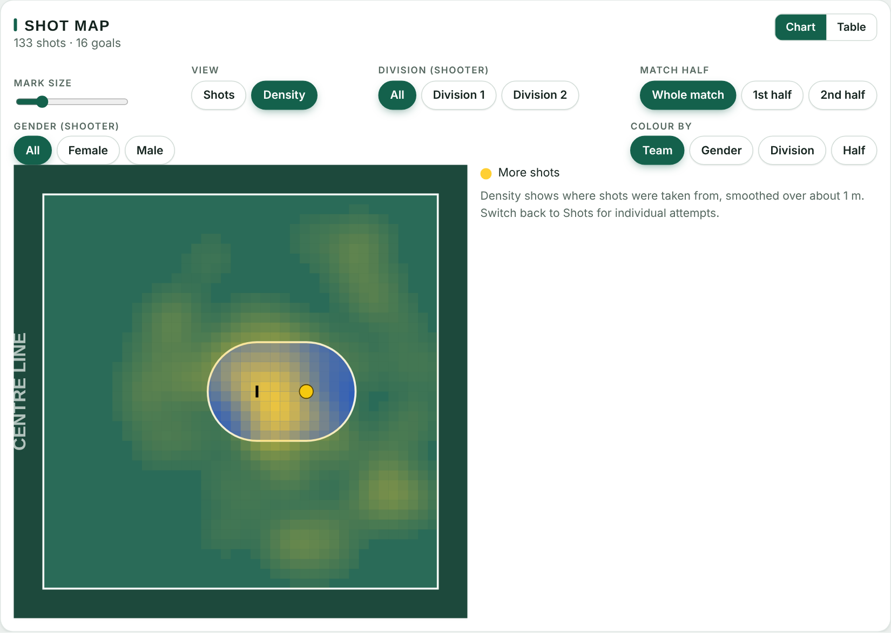

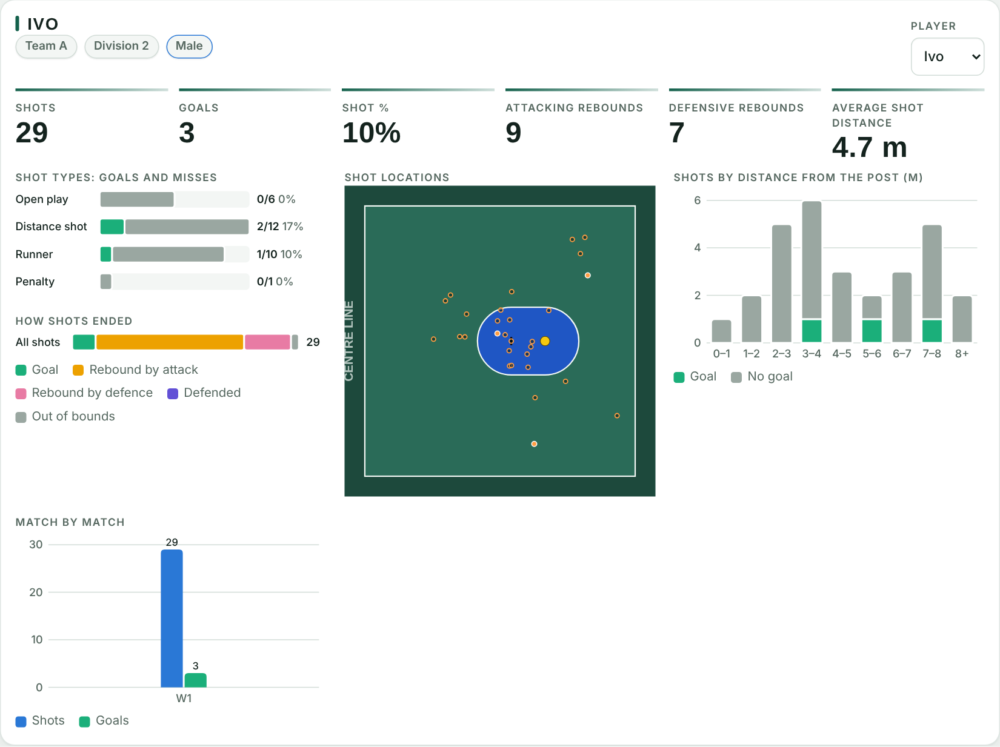

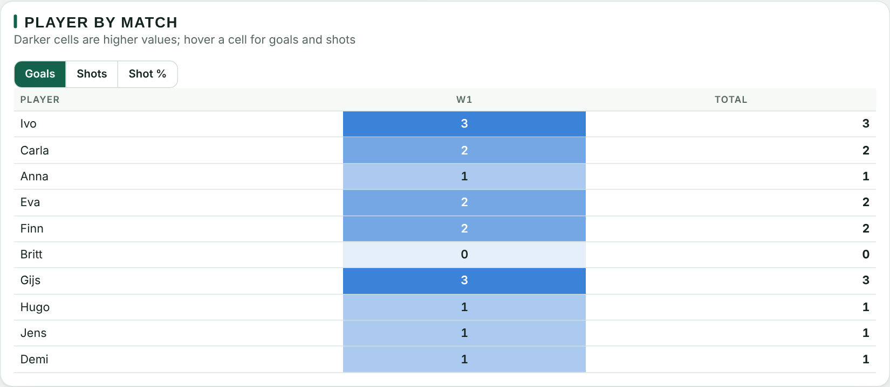

## 3. Print reports

- **Print team report:** a paginated PDF of the team dashboard for the team and match you have selected. Unlike the screen, which shows one shot map at a time, the printed report shows several shot maps side by side, one for each way of colouring the shots (see Figures 12 and 13).
- **Print coach report:** team statistics followed by every player.
- **Print player reports:** tick the players you want. A print window opens once per player, so choose **Save as PDF** each time.
- **PDF file names:** the print window suggests a file name. For one match it is the match as shown in the Match box (for example Team A v Team B · Week 1 · 2026-10-04); for several matches it is the team name followed by "season report". The coach report adds _Coach, and each player report adds _ and the player's name.
- If printing is blocked inside the embedded view, open Korf Lab in its own browser tab.

**Printed shot maps.** The report prints every colouring of the shot map at once, whatever filter is set on screen: by team, by shot type, by gender, by division and by half. Each map shows the same shots, so you can compare who took them and when. The team's opponents get their own set of maps. These are coloured by gender and division as well when the opponent's players are named in Korf Log, and by team and half only when they are not.

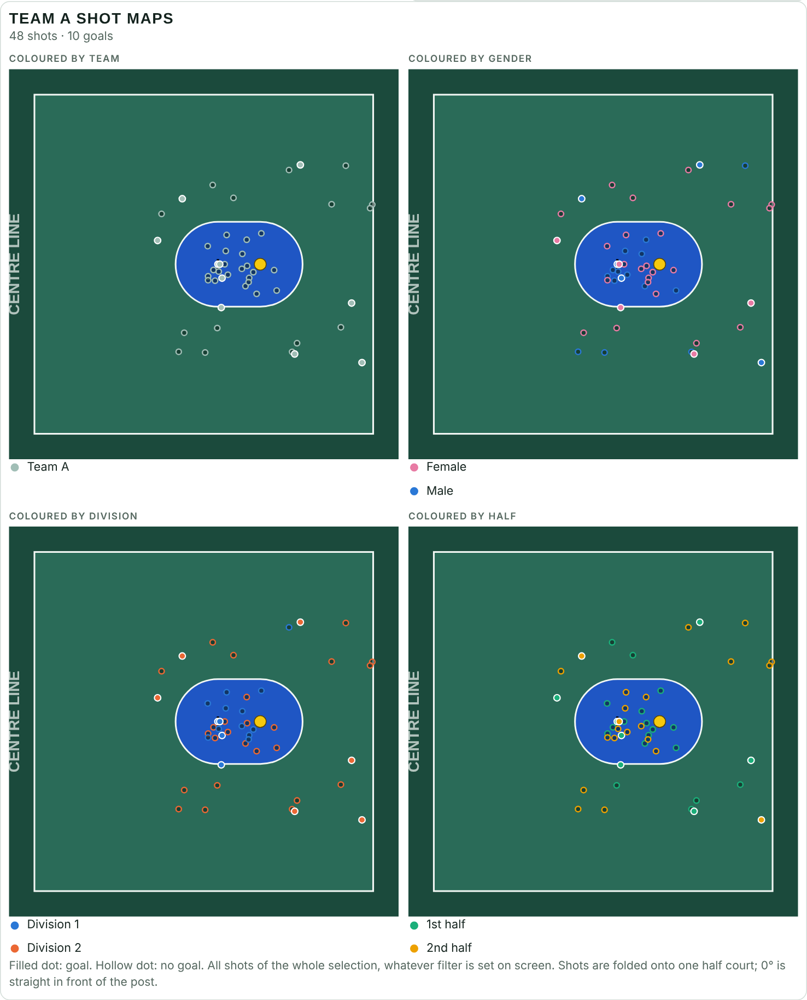

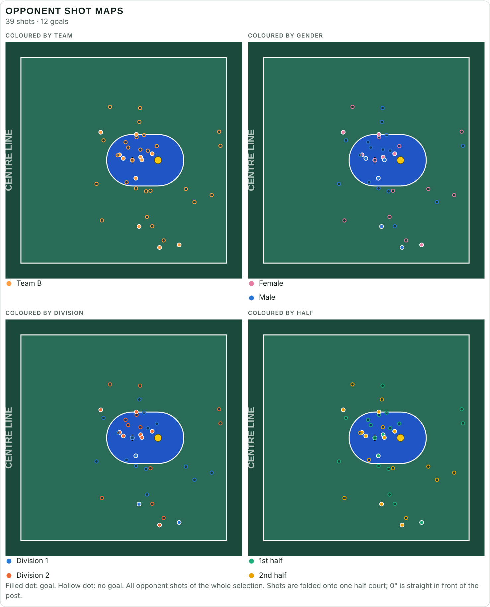

## 4. Colours

Korf Log saves the team, court and circle colours in both its CSV and JSON exports. Korf Lab reads the CSV files and uses the team colours stored in them, and adjusts them where they would be hard to see against the shot map. It uses the logged court and circle colours when every loaded log agrees. Otherwise it falls back to its default green court with blue circles.

## 5. Convert a Yellow Bucket export

If you track shots in Yellow Bucket, you can turn its Shot Location export (a CSV) into an event log that Korf Lab reads.

1. In **Data sources**, scroll to **Convert a Yellow Bucket export** and pick the CSV file.
2. A dialog shows how many shots each team took. Choose the **league** and **fixture date** (both required; the date is filled in from the file name when it contains one), and optionally the fixture week, match length and which team is listed first.
3. Pick a **colour for each team** with the colour pickers. The colours are saved in the converted file, so they are used in all charts and maps.
4. Choose **Save file only** to download the converted CSV, or **Save file and view stats** to download it and open it in Korf Lab straight away.

**What you get.** Shots, goals, shot %, shot types (open play, free pass, penalty), rebounds by team, shots by distance, goals by 5-minute block, score progression, the shot map and density view, and shots and goals for each named shooter.

**What you do not get.** Yellow Bucket exports do not record passes, attacks, turnovers, substitutions, division or gender, so those views stay hidden. Unless recorded, opponent shots usually have no shooter name, so only named players appear on the Players page. An "other" outcome is shown as out of bounds.

**Simulated court.** Markers on the shot map are plotted on a simulated 40 × 20 m court, using each shot's distance and angle from the post, so treat positions as approximate.

**Privacy.** This site counts anonymous page visits and file downloads (no cookies, no personal data). Your match data never leaves your browser.

*Korf Lab is created by Eric Van Looy.*
