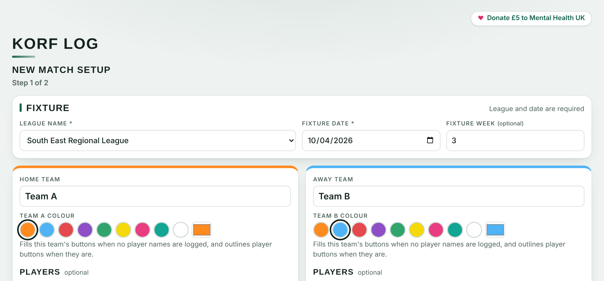
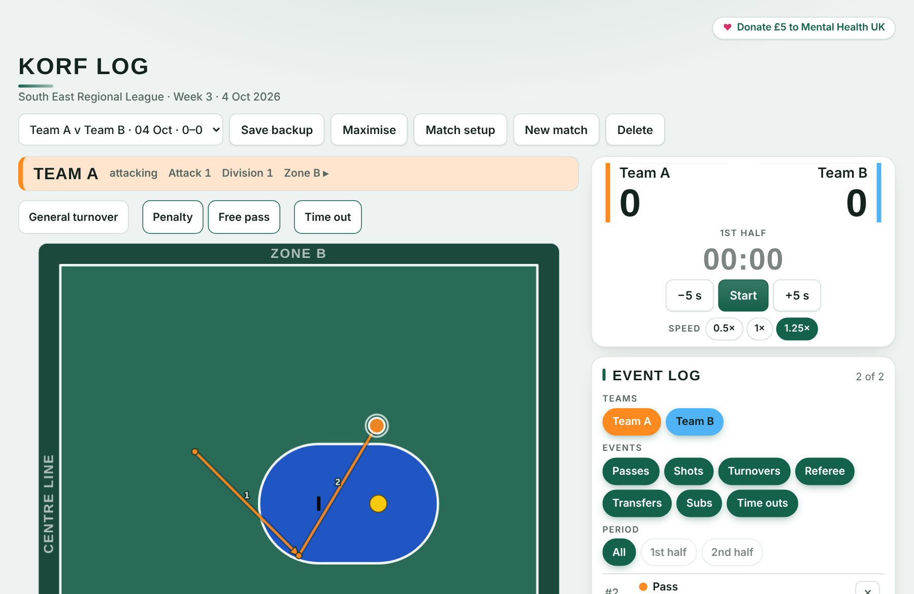
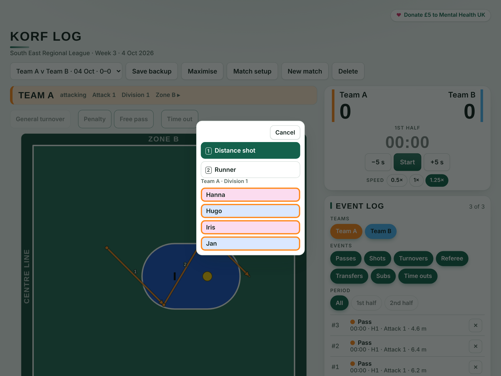
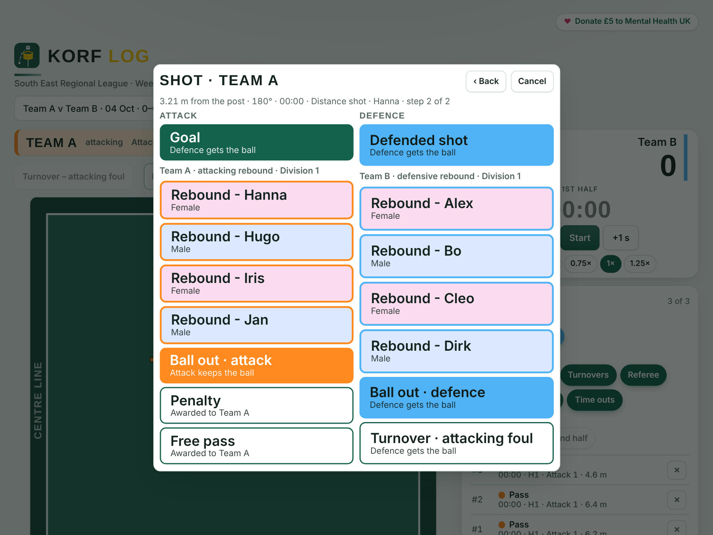
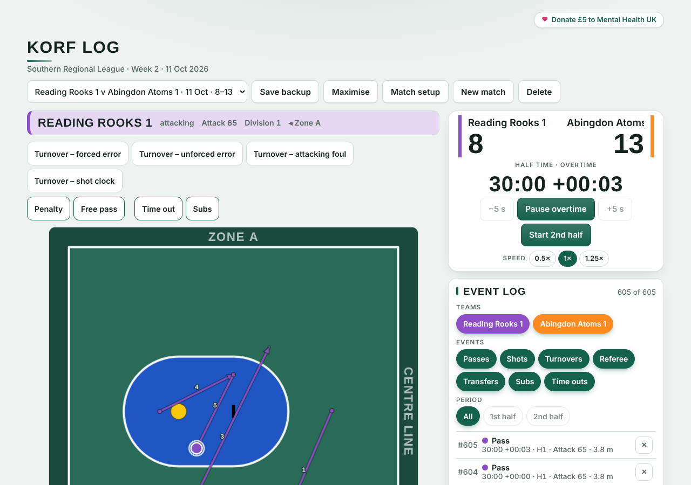

# Korf Log: user guide

Korf Log records a korfball match as it is played, one click at a time, and exports an event log that Korf Lab turns into team and player reports.

## 1. Set up a match

- **Fixture and teams:** enter the league (pick from the England Korfball list, or choose Other and type a name) and the fixture date (both required), the fixture week (optional) and the two team names. Pick a colour for each team. The match list shows each match as Team A v Team B, fixture date and score. Korf Lab uses the fixture week to order matches, or the fixture date when the week is empty.
- **Players (optional):** add name, number, division and gender, plus substitutes. Without names you still log every shot and pass.
- **Match format:** 60 min is the default; other lengths and halves or quarters are available. Set the court size and choose the court and *Free pass & penalty circles* colours.
- **Events to track:** tick passes, shots, referee calls and turnovers.
- **Opening attack:** choose the team in possession first and its attacking direction. When names are logged, also choose the division attacking first.

## 2. Track the match

| To log | Do this |
| --- | --- |
| Clock | Start or pause with the clock button or the space bar. The −5 s and +5 s buttons correct the time. Under them, the Speed buttons run the clock at 0.5× (slower), 1× (normal) or 1.25× (faster). The speed is saved with the match. The clock stops at the end of each half (30:00 in a 60-minute match) and shows Half time: the court is locked and the clock button becomes Start 2nd half. Press that button when play restarts; the space bar does not start the next half. At full time the clock stops for good (use −5 s if the time needs correcting). |
| Passes | Click the court for the start of the first pass. Each next click ends one pass and starts the next. |
| Shot | Double-click where it was taken. **Step 1:** pick the shot type (Distance shot is pre-selected; press 1 for Distance shot or 2 for Runner) and, if names are logged, the shooter. Click the selected type again, or press Enter, to continue with the shooter unknown. **Step 2:** Goal, a rebound, Ball out, or Defended shot. Attack options sit in the left column, defence in the right. |
| Other events | Penalty, Free pass, turnover tiles, Time out and Subs sit above the court. |
| Mistakes | Press Ctrl+Z (Cmd+Z on a Mac) to undo the last event. Esc closes a popup. |

Team colours fill each team's buttons. Where names are logged, player buttons get a coloured border instead.

## 3. Save, resume and export

- Matches are kept in your browser, so you can stop and finish a match later. **Save backup** downloads a file you can import again. To carry on a saved match, open **New match** and use **Continue a saved match** at the top of the setup page: choose the backup file (.json or .csv) and tracking opens with the clock where it stopped. The Import box under the event log does the same.
- **Export** gives the event log as CSV or JSON. Choose the format, then read it in the box, copy it, or save it as a file with the button beside the choice (Save CSV file or Save backup file). Korf Log and Korf Lab both read JSON and CSV. A JSON backup is exact; a CSV rebuilds the match from its events, so players who never shot, collected a rebound or were named in a substitution are missing from the player buttons. Both formats record the team, court and circle colours, so Korf Lab can use them.
- **Maximise** hides everything except the clock and speed buttons, score, tracking buttons, a one-line log of the last event (with a delete button) and the court. **Match setup** edits the current match. **New match** starts another, keeping the teams and colours.

*Korf Log is created by Eric Van Looy.*
