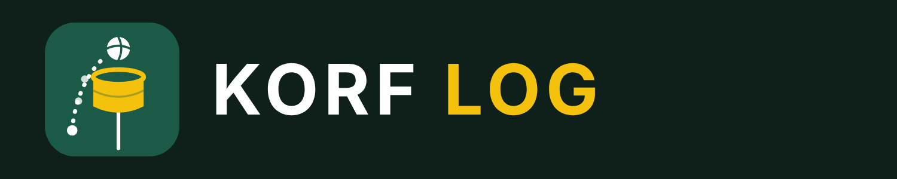

# Korf Log: user guide

Korf Log records a korfball match as it is played, one click at a time, and exports an event log that Korf Lab turns into team and player reports.

**Video tutorial:** watch a 90-second walkthrough, including match video and the Time out buttons: [Korf Log tutorial](https://ericvl-korf.github.io/korf-tools/tutorials/korf-log-tutorial.mp4). It is also behind the **Video tutorial** button at the top of the page.

## 1. Set up a match

- **Fixture and teams:** enter the league (pick from the England Korfball list, or choose Other and type a name) and the fixture date (both required), the fixture week (optional) and the two team names. Once a league from the list is chosen, the Home and Away team names are dropdowns of that league's teams (as listed on the England Korfball League Republic site); choose Other to type a team that is not listed. A team cannot be picked for both sides. Pick a colour for each team. The match list shows each match as Team A v Team B, fixture date and score. Korf Lab uses the fixture week to order matches, or the fixture date when the week is empty.
- **Players (optional):** add name, number, division and gender, plus substitutes. Without names you still log every shot and pass. Once a team has a named player, Korf Log checks its starting line-up and shows a warning under the player list: each division must have 4 players, the team must have 4 male and 4 female players, and each division should field 2 male and 2 female players. You cannot continue until the line-up is right. Substitutes can be any gender and are not counted. A team with no named players is not checked.
- **Match video (optional):** paste the YouTube link, or choose a video file on your computer, and enter the video time at which the clock starts in each half (for example 04:10). If the match is in two videos, tick **The match video is split into one video per half** and give each half its own link or file and start time. Links and times that are wrong, such as a link that is not from YouTube or a time that is not minutes:seconds, are listed under *Before you continue* and must be fixed first. A file stays on your computer and has to be chosen again each time Korf Log is opened; the link, file name and start times are saved with the match and carried into Korf Lab.
- **Match format:** 60 min is the default; other lengths and halves or quarters are available. Set the court size and choose the court and *Free pass & penalty circles* colours.
- **Events to track:** tick passes, shots, referee calls and turnovers. For shots, choose **Log separate shot types** (Distance shots or runners) or **Do not log separate shot types**; with the second choice the shot popup skips the shot-type step. For passes, choose **Full tracking** (one click per pass on the court; logs pass location and pass count) or **Count tracking** (click anywhere on the court to add a pass to the attack; logs pass count only, not location).
- **Opening attack:** choose the team in possession first and its attacking direction. When names are logged, also choose the division attacking first. A team without player names is shown by its team name alone in the picture. In the 2nd half the teams swap ends and the team that did not have the opening attack attacks first. The divisions that were attacking stay in attack; divisions only switch after every second goal of the two teams combined.

## 2. Track the match

| To log | Do this |
| --- | --- |
| Clock | Start or pause with the clock button or the space bar. The −1 s and +1 s buttons correct the time by a second at a time. Under them, the Speed buttons run the clock at 0.5× or 0.75× (slower), 1× (normal) or 1.25× (faster). The speed is saved with the match. When regular time ends (30:00 in the 1st half of a 60-minute match) the clock runs straight on into extra time, with no action from you, and reads 30:00 +00:00, 30:00 +00:01 and so on. Events are logged as 30:00 +mm:ss (60:00 +mm:ss in the 2nd half). Press End 1st half when the half is over: the 2nd half is then set up with the clock stopped at 30:00 (the space bar never starts it); press Start when play begins. At the end of the 2nd half press End match. While extra time runs, the clock button pauses or resumes the extra time stopwatch. The −1 s button never goes back past the start of the current half or, in extra time, past +00:00, and +1 s is disabled in extra time. |
| Passes | **Full tracking:** click the court for the start of the first pass. Each next click ends one pass and starts the next. **Count tracking:** click anywhere on the court (or press the P key) for each pass in the attack; the hint under the court shows how many passes the attack has so far. No location is logged. A double-click still logs a shot, and its first click is not counted as a pass. |
| Shot | Double-click where it was taken. (If shot types are switched off in the setup, there is no shot-type step: with player names you pick the shooter or Skip, otherwise you go straight to the outcome.) **Step 1:** pick the shot type (Distance shot is pre-selected; press 1 for Distance shot or 2 for Runner) and, if names are logged, the shooter. Click the selected type again, or press Enter, to continue with the shooter unknown. **Step 2:** Goal, a rebound, Ball out, or Defended shot. Attack options sit in the left column (Goal, the attacking rebounders or team, Ball out · attack, Penalty, Free pass), defence in the right (Defended shot, the defensive rebounders or team, Ball out · defence, Turnover · attacking foul). Penalty, Free pass and Turnover · attacking foul are for referee calls made while the ball is still loose after the shot: the shot is logged with the outcome Rebound · Foul for the side that gets the ball (it appears in the event log; it is not a button you click), followed by the call. Korf Lab treats it as a rebound by that side and does not count Foul as a rebounding player. Both steps cover the court, and the tiles fill the frame. |
| Other events | Penalty, Free pass, turnover tiles, Time out start, Time out end and Subs sit above the court. Time out start stops the match clock and Time out end restarts it; the video keeps playing in between (see Match video). |
| Mistakes | Press Ctrl+Z (Cmd+Z on a Mac) to undo the last event. Esc closes a popup. |
| Match video | Under the court, paste a YouTube link into Match video and press Show video. The player appears under the court, and in Maximise the court gets a little smaller to make room for it. Open on YouTube, Video −1 s / +1 s, Both −1 s / +1 s, Change link and Remove video sit under the player. **The clock and the video start and pause together:** start or pause the clock (button, space bar or Time out) and the video follows; press play or pause in the video and the clock follows (a clock stopped at the end of a half is not restarted by the video). The clock's −1 s / +1 s buttons move only the clock and the video's −1 s / +1 s buttons move only the video, so you can line the two up: pause both, nudge whichever is out, then start them together. The **Both −1 s / +1 s** buttons move the clock and the video together by the same amount, so they stay lined up while you rewind or fast forward (going back removes events after that time, as the clock's −1 s does). **The video plays at the clock's speed:** when you choose 0.5×, 0.75×, 1× or 1.25× with the Speed buttons, the video changes to the same speed, and if you pick one of those four speeds in YouTube's own player the clock follows. YouTube's other speeds are not available on the clock, so the video goes back to the clock's speed. The video's buttons are hidden in Maximise, so align before maximising. **Start moves the video to the right moment** (the half's start time plus the time on the clock) and the video's and clock's −1 s / +1 s buttons also update the saved start time, so the alignment carries on to the next match export. When the match is split, the second half's video loads when you start the second half. Instead of a link you can use **Choose video file**; a local file works in a copy of Korf Log opened from your computer too. The link is saved with the match, in the JSON backup and in the CSV export (video_url, video_url_2, video_start_1, video_start_2, video_file_1 and video_file_2 columns). **The player only works when Korf Log is opened from a web address, such as the GitHub Pages link**. In a file opened from your computer, or inside the Claude page, YouTube refuses to play it, so use the Open on YouTube link there. The player is YouTube's own, so YouTube may set its own cookies when you press play. **Time outs and the video:** the match clock stops in a time out but the video usually does not. Press **Time out start** when the time out begins and **Time out end** when play restarts: the clock stops and restarts, the video is left running, and Korf Log notes the video time of both. That span is then skipped when the clock and video are lined up (Start moves the video to the right moment, counting earlier time outs in the same half) and when Korf Lab builds highlight reels. Time out start and end are exported as Time out rows with a video_time_s column. While a time out is running the clock cannot be started from its button or the space bar; press Time out end. |

**Why the Time out buttons matter.** The match clock stops during a time out, but a match video keeps running. Every time out you do not mark makes the video drift further from the clock, so highlight clips made in Korf Lab start later and later than the real play. Press **Time out start** the moment the clock should stop and **Time out end** when play restarts, for every time out in the match, so Korf Log and Korf Lab can skip that stretch of video. If you log without a video you can still use them; they are then just a record of the time outs.

Team colours fill each team's buttons. Where names are logged, player buttons get a coloured border instead.

## 3. Save, resume and export

- Matches are kept in your browser, so you can stop and finish a match later. **Save backup** downloads a file you can import again. To carry on a saved match, open **New match** and use **Continue a saved match** at the top of the setup page: choose the backup file (.json or .csv) and tracking opens with the clock where it stopped. The Import box under the event log does the same.
- **Export** gives the event log as CSV or JSON. Choose the format, then read it in the box, copy it, or save it as a file with the button beside the choice (Save CSV file or Save backup file). Korf Log and Korf Lab both read JSON and CSV. A JSON backup is exact. A CSV rebuilds the match from its events and from the starting line-up rows at the top of the file (each team's named players and substitutes, their divisions and which division attacks first), so the full squad comes back when you import it; older CSVs without line-up rows only know players who shot, collected a rebound or were named in a substitution. Both formats carry the starting line-up, which Korf Lab uses to work out minutes in attack and in defence. Both formats record the team, court and circle colours, so Korf Lab can use them. Events logged in extra time show as 30:00 +mm:ss in the time column; the extra time seconds are in an extra extra_time_s column.
- **Maximise** hides everything except the clock and speed buttons, score, tracking buttons, a one-line log of the last event (with a delete button) and the court. **Match setup** edits the current match. **New match** starts another, keeping the teams and colours.

**Privacy.** This site counts anonymous page visits and file downloads (no cookies, no personal data). Your match data never leaves your browser.

*Korf Log is created by Eric Van Looy.*
